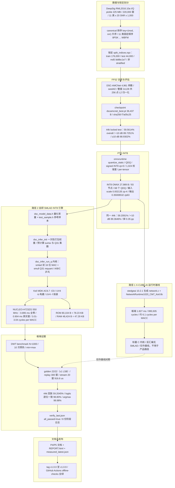
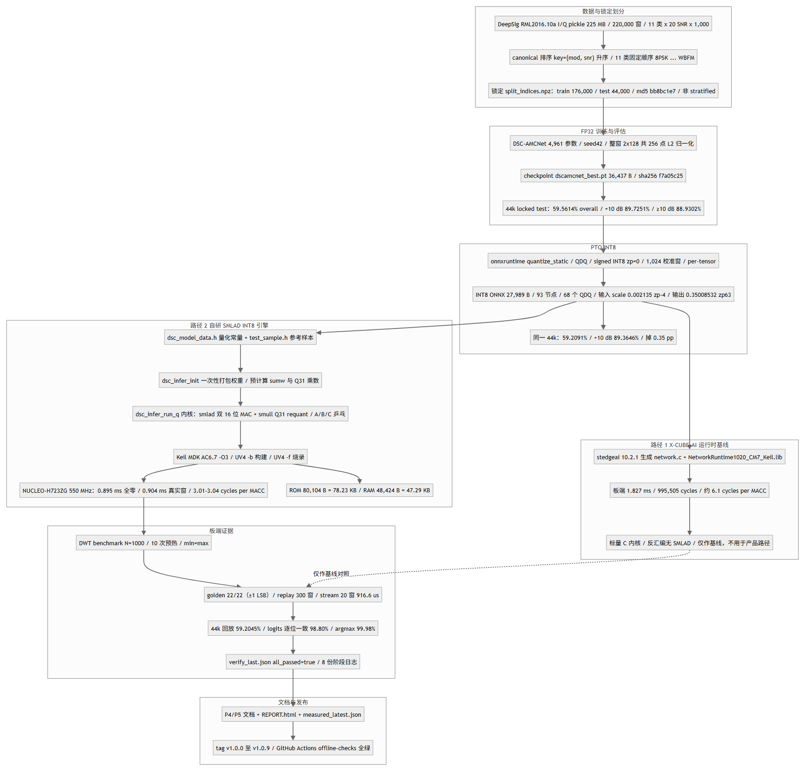
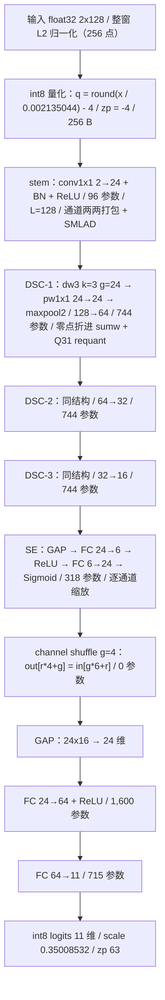
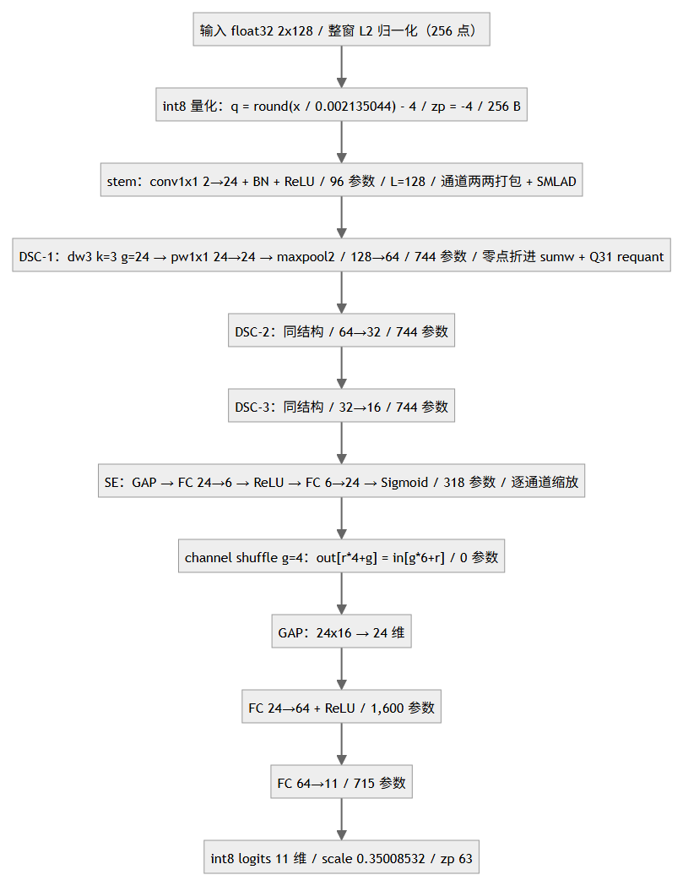
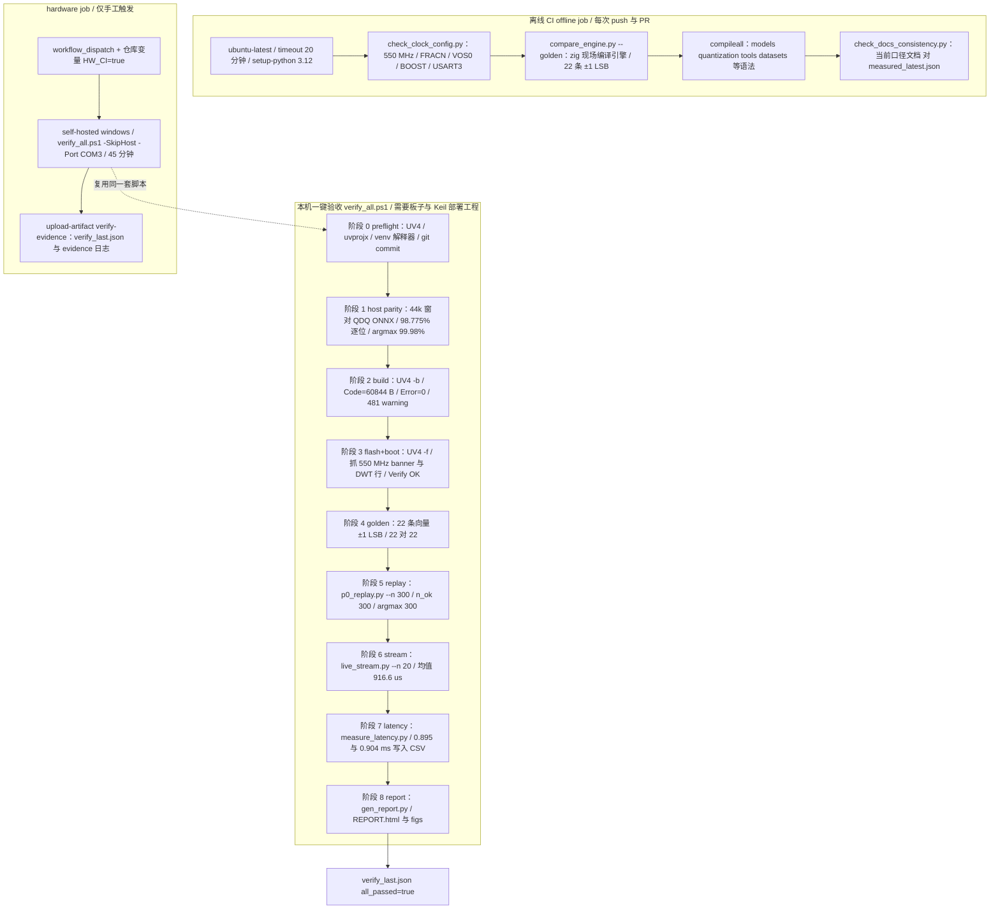
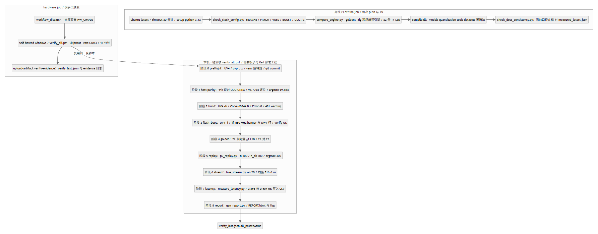

# 项目地图：流水线 / 引擎 / 工具链

> 仓库：`D:\dsc-amcnet-cortex-m7-amc`；本文生成于 2026-11-01。
>
> 数字口径：当前值取 `stm32_deployment/results/measured_latest.json` 的
> `p2_clock_550mhz_2026_10_31` 段（550 MHz、C1 内核），并与
> `docs/P4_OPTIMIZATION.md`、`docs/P5_*.md`、`README.md` 交叉核对。
> 544 MHz 时代或 C1 之前的读数一律标注「历史」。
> 未复现项（OTA、ULCNN 部署、能耗）只出现在文末说明里，图中不画成已完成节点。
>
> 三张图各管一段：**A** 从数据到板端证据的全链条，**B** 自研引擎内部的
> int8 数据流与四个实现要点，**C** 把「本机一键验收 + 离线 CI」拆到阶段级。
>
> Mermaid 源在每个代码块里（GitHub 直接渲染）；图下另附 PNG 渲染版
> （`figs/project_flow_{a,b,c}.png`，由 mermaid 10.9.1 + headless Chrome 生成）。
>
> 本文件与目录索引都在 `completion_flow/` 目录下（交付物目录）。

## 图 A：端到端流水线

**图注 A**（关键数字与来源）：

- 数据：220,000 窗 = 11 类 × 20 SNR × 1,000；`.dat` 225,292,173 B、sha256
  `889ac648…`（`measured_latest.json` 的 `dataset` 段）。`split_indices.npz`
  为 train 176,000 / test 44,000，**非 stratified**（每 cell test 166–239），
  md5 `bb8bc1e7c41a58fad6f08a23ae7ef76d`，不可重生成。
- 精度三段：FP32 59.5614% / 89.7251% / 88.9302%，INT8 59.2091% / 89.3646% /
  88.4410%，掉点 0.35 / 0.37 / 0.49 pp（`docs/P4_OPTIMIZATION.md` §量化方案对照）。
  44k 样本里 +10 dB 共 2,219 窗、≥10 dB 共 11,039 窗（A4 口径修正后）。
- ONNX：实测 **93 节点 / 68 个 QDQ**、int8 图 27,989 B（`README.md` 参数口径节、
  `measured_latest.json` 的 `model` 段）。
- 两条路径从**同一份 INT8 ONNX** 分叉：路径 1 是 X-CUBE-AI 运行时基线
  （1.827 ms，995,505 cycles，约 6.1 cycles/MACC），路径 2 是自研引擎。
  两者共用同一块 NUCLEO-H723ZG、同一个 Keil 工程；运行时库仍在链接，只用于
  banner 与基线对照（`stm32_deployment/custom_engine/README.md` §注意）。
- 23.6% 与 2.02× 的算法：`0.904 / 1.183 = 0.764` → 比论文快 23.6%；
  `1.827 / 0.904 = 2.02`。cycles/MACC = 492,250 / 163,615 = 3.01（全零）、
  497,200 / 163,615 = 3.04（真实窗）。
- 历史值（勿当当前值引用）：C1 前 0.951 / 0.960 ms；C1 后 544 MHz 时
  0.905 / 0.914 ms；P4 前 0.967 / 0.975 ms。

## 图 B：自研引擎数据流

**图注 B**（层序与四个关键实现）：

层序与 `models/dsc_amcnet.py` 一致：长度 128 → 64 → 32 → 16；SE 只在
pool 之后的最后一级（dsc3 后）；shuffle 在 SE 之后、GAP 之前。逐层 cycle
（544 MHz 真实样本，合计 515,323）显示三个 1×1 卷积占 55%、三个深度卷积占
23%，所以内核优化集中在 conv1x1 打包与 dw3 边界（`docs/P4_OPTIMIZATION.md`
§逐层 cycle 剖析）。

四个实现要点（均在 `stm32_deployment/custom_engine/dsc_infer.c`）：

1. **权重/输入通道两两打包**：`pk2()` 把两个有符号 8 位值放进一个 32 位字的
   低/高半字；`pack_w()`（:86）在 `dsc_infer_init()` 里把每行权重按通道对
   预打包（`wp1/wp3/wp5/wp7/wfc1/wfc2/wcl0/wcl3`），推理时输入也按通道对
   打包成 `buf[p]`，一条 SMLAD 吃掉两个通道。
2. **SMLAD 双 16 位 MAC**：`smlad()`（:35）用 `__asm volatile("smlad …")`
   （:44）把两个 16 位乘法累加进 32 位 acc；conv1x1 每个 tap 两个通道一次算完
   （:179-180），dw3 每个输出用相邻样本对拼成 packed word，一次算两个 tap
   （:206-227）。
3. **输入零点折进 sumw**：`sum_rows()` 预计算每行权重和，偏置预先重定位为
   `b = bias - zp_in * sumw`（:139-144）：输入层 zp=-4 → `b1 = b_c1 + 4*sumw1`，
   其余层 zp=-128 → `+128*sumw`；dw3 的时间轴补零用 q=-128（实数 0），
   边界两对移出循环、循环内无分支（:185 注释、:206-227）。
4. **Q31 定点 requant**：`rq()`（:54）用 `smull` 取 64 位乘积的高低字，
   `hi + (lo >> 31)` 精确等价于 `floor((acc*mq31 + 2^30) / 2^31)`；`q31()`
   （:84）返回 `2*round(m*2^31)` 的 Q32 乘数，各层乘数在 `:154-164` 一次算好。
   C1 之前是 int64 乘 + 舍入（较慢但同值）；`DSC_HOST_SIM` 分支保留 int64
   版本，供主机侧逐位对照（`stm32_deployment/tools/host_sim/`）。
   量化域：激活 zp=-128（无符号域 u=q+128）、输入 zp=-4、SE 的 fc2 输出
   zp=-5、logits zp=63、权重/偏置 zp=0。

## 图 C：工具链与 CI

**图注 C**：

- `stm32_deployment/tools/verify_all.ps1` 的编号是 0–8：preflight + 8 个验收
  阶段（`docs/BUILD.md` §4.1 表）。失败即整体退出码非 0，判据分别是：
  host parity 的 bit-exact < 95% 或 argmax < 99%、build 有 Error、串口缺
  `[DWT]`/`Verify OK`、golden 非 22/22、replay n_ok 或 argmax 非 300、
  stream 未满 20 窗、latency CSV 少于 2 行、report 脚本失败。
- 产物：`stm32_deployment/results/verify_last.json`（schema
  `dsc-amcnet-verify-v1`，`all_passed=true`）+ 8 份阶段日志；latency 另写
  `docs/evidence/latency_dscamcnet_int8.csv`。注意 `replay.log`、
  `host_parity.log`、`latency_stage.log` 等被 `.gitignore` 忽略，clone 后需
  重跑才能得到。
- 离线门禁三项：时钟配置、22 条 golden 主机侧逐位、文档口径；外加
  `compileall` 语法检查。`hardware` job 只在手工触发且 `HW_CI=true` 时跑，
  用 `-SkipHost` 跳过 44k 主机对比（225 MB 数据集不在 runner 上）。
- 当前所有检查对应同一份当前口径：550 MHz、0.895/0.904 ms、78.23/47.29 KB、
  59.2091%（`check_docs_consistency.py` 会拦住陈旧数字）。

## 关键数字速查（本文引用的事实源）

| 数字 | 值 | 出处 |
|---|---|---|
| 单次推理 | 0.895 / 0.904 ms @550 MHz | `P4_OPTIMIZATION.md` §最终结果、`measured_latest.json` p2 段 |
| 对照基线 | 1.827 ms / 995,505 cycles | `README.md` 实测节、`P1_BENCHMARK.md`、`PROJECT_MEMORY.md` §5 |
| 比论文 | 快 23.6%（0.904 对 1.183） | `measured_latest.json` p2 段、`README.md` |
| 比运行时 | 2.02×（1.827 对 0.904） | 同上 |
| cycles/MACC | 3.01–3.04（MACC 163,615） | `P4_OPTIMIZATION.md` §最终结果 |
| 精度 FP32 | 59.5614%（+10 dB 89.7251%） | `P4_OPTIMIZATION.md` §量化方案对照 |
| 精度 INT8 | 59.2091%（+10 dB 89.3646%，-0.35 pp） | `ref_accuracy.json` |
| 板端 44k | 59.2045%，逐位 98.80%，argmax 99.98% | `p5_accuracy_44k.json`、`P5_ACCURACY.md` |
| golden / replay / stream | 22/22、300 窗、20 窗 916.6 us | `measured_latest.json` p2 段 |
| 资源 | ROM 80,104 B（78.23 KB）/ RAM 48,424 B（47.29 KB） | `P5_RESOURCES.md`、p2 段 |
| ONNX | 93 节点 / 68 QDQ / 27,989 B | `README.md` 参数口径、`measured_latest.json` model 段 |

> 未复现：OTA 82.76%（无射频前端）、ULCNN 部署（上游无 C 工程）、能耗
> 0.091 mJ（无电流表）。这三项只在 `README.md`、`docs/P5_BLOCKED.md` 中作为
> 「未验证」出现，不参与本文任何比较。
